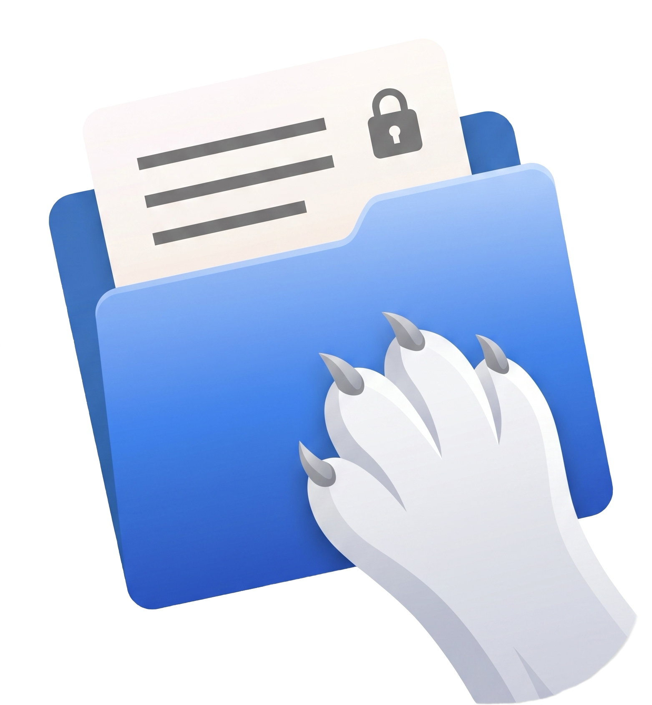
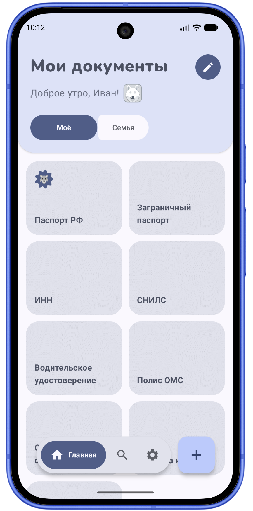
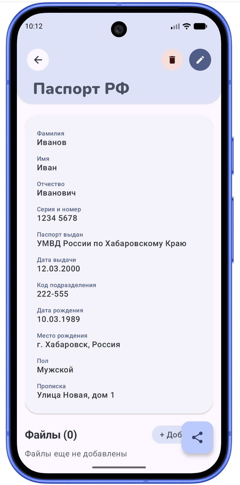
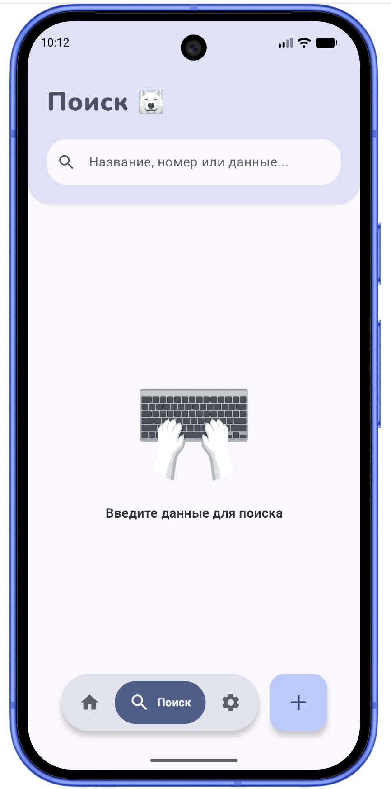
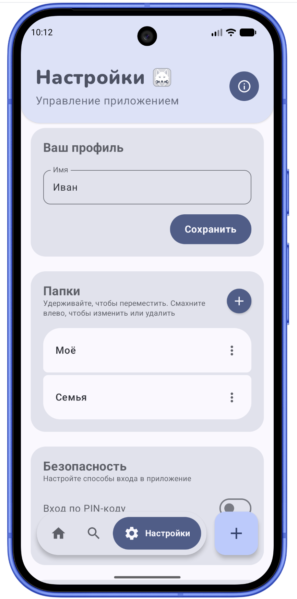
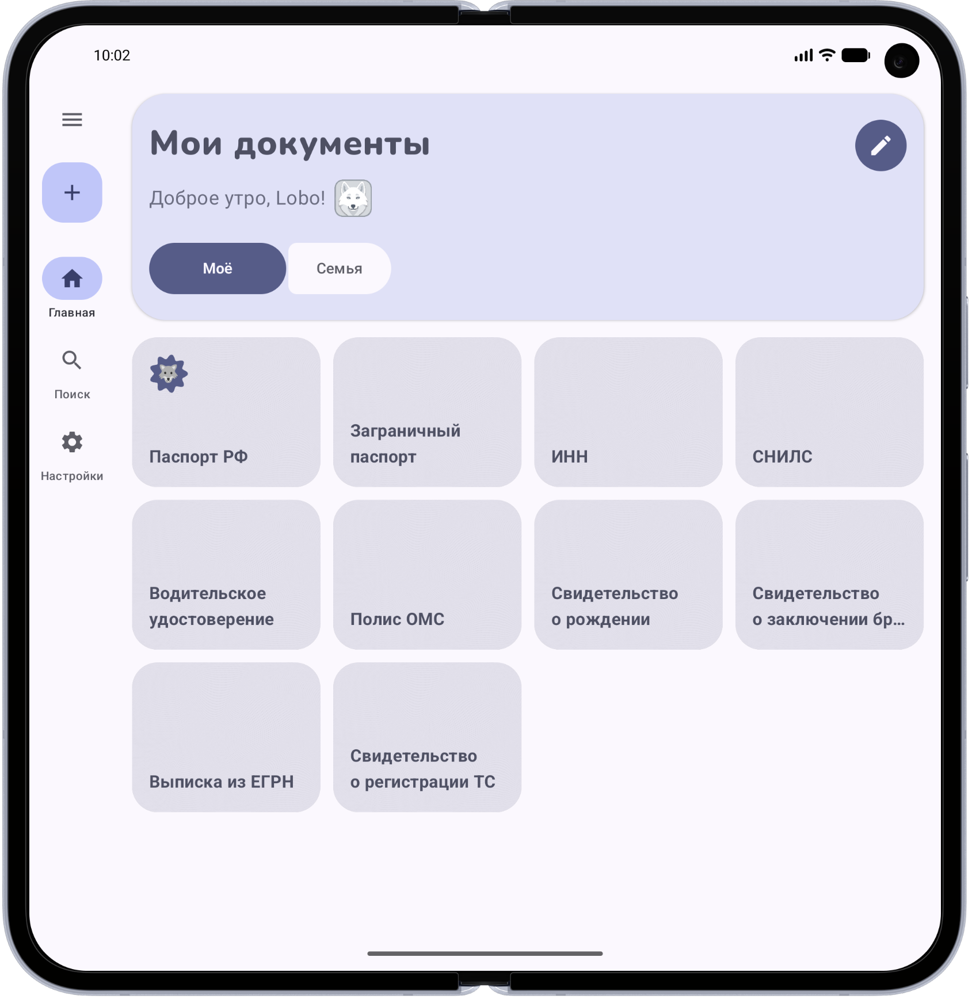
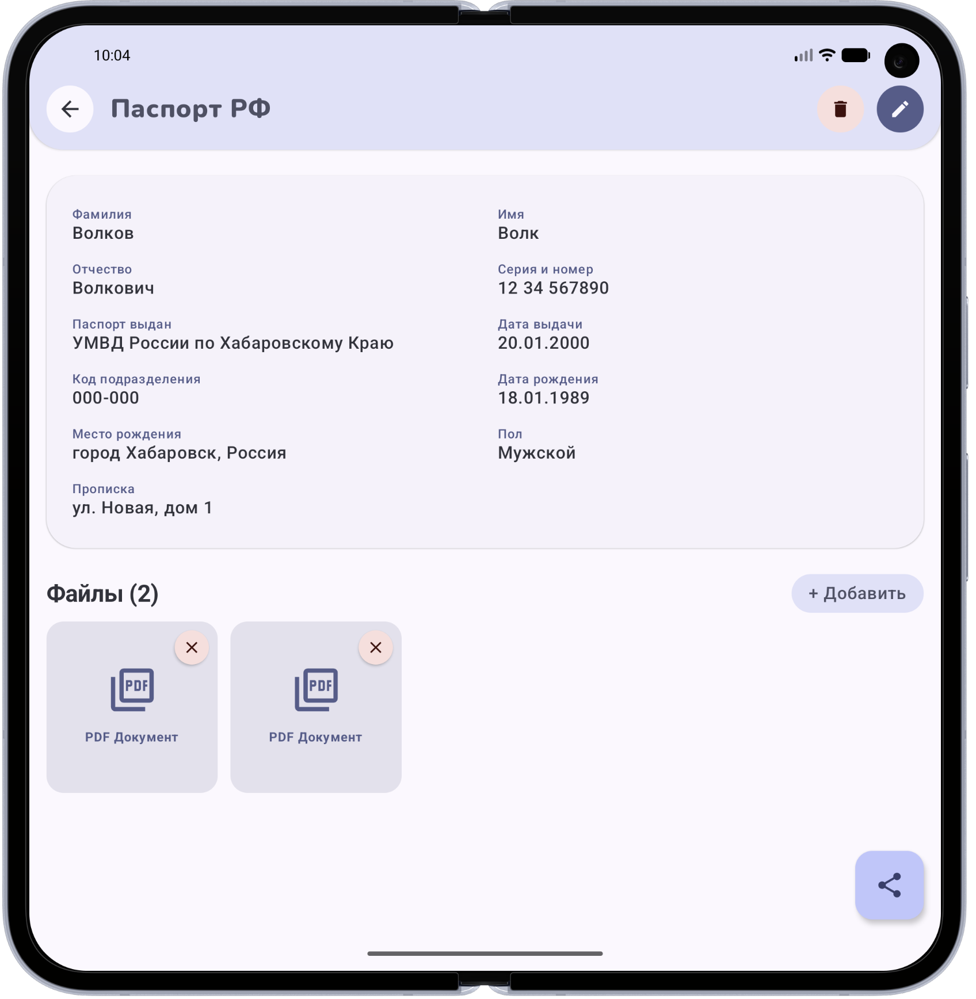
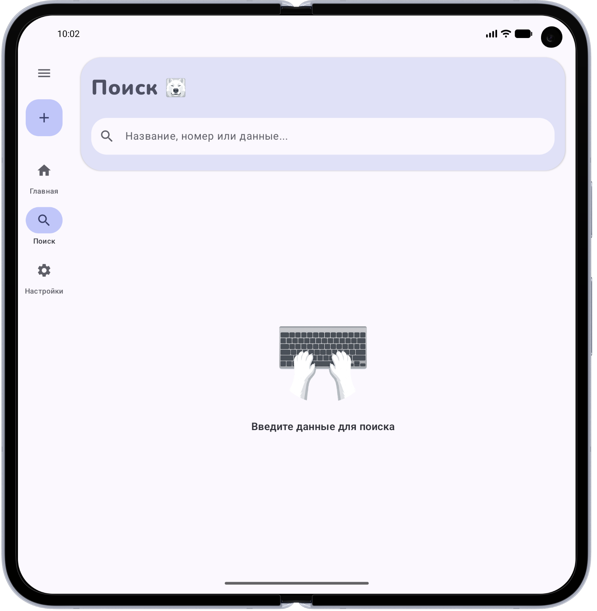
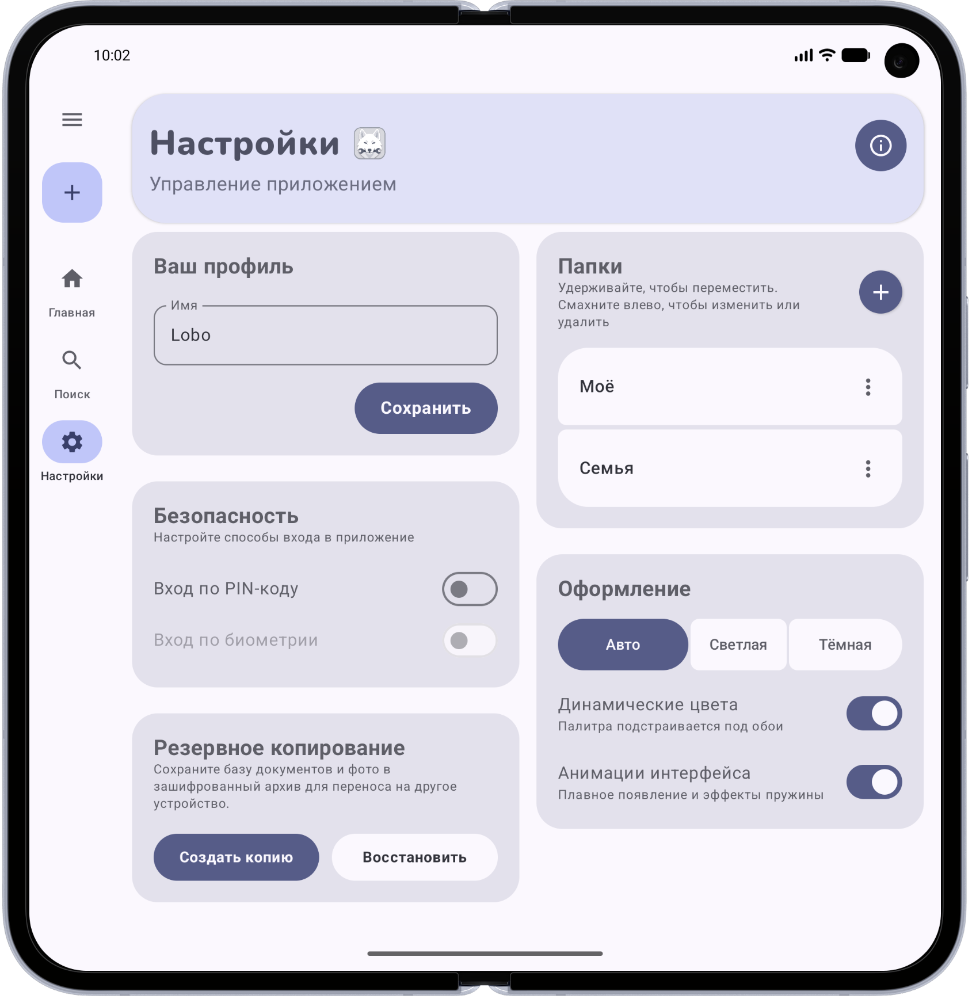

<p align="center">
  
</p>

<h1 align="center">Мои Документы</h1>

<p align="center">
  Личный архив документов для Android. Храните важные данные, фотографии и файлы в одном месте и быстро находите нужное на смартфоне или планшете.
</p>

## Возможности

- **Папки для документов.** Создавайте отдельные папки для себя и членов семьи, меняйте их названия и порядок. Порядок карточек документов на главной странице тоже можно настроить.
- **Шаблоны документов.** Заполняйте готовые формы для паспорта РФ, заграничного паспорта, ИНН, СНИЛС, полиса ОМС и других документов.
- **Собственные поля.** Для документа типа «Другое» добавляйте, переименовывайте и удаляйте поля, меняйте их порядок. Можно использовать стандартный шаблон или сохранить свой для следующих документов. Изменения шаблона не меняют поля уже созданных документов.
- **Вложения.** Прикрепляйте фотографии и PDF-файлы к карточкам документов. Для удобства документам можно назначать эмодзи-теги.
- **Поиск и обмен.** Ищите документы по названию и содержимому полей, копируйте отдельные значения или отправляйте данные документа в текстовом виде.
- **Резервные копии.** Создавайте защищённую паролем копию данных и вложений и восстанавливайте её на устройстве.
- **Персонализация.** Выбирайте системную, светлую или тёмную тему, динамические цвета, настраивайте анимации и виброотклик. Доступны русский и английский языки.
- **Адаптивный интерфейс.** Приложение использует Material Design и поддерживает смартфоны, планшеты и складные устройства. На больших экранах доступна боковая панель навигации.

## Безопасность и хранение

Документы хранятся локально на устройстве; для основных функций подключение к интернету не требуется. База данных зашифрована с помощью SQLCipher, а вложения хранятся в зашифрованном виде. Для переноса данных предусмотрены резервные копии, защищённые паролем.

В настройках можно включить PIN-код и биометрию, а также запретить снимки экрана. При включённой блокировке приложение запросит повторный вход после нахождения в фоне более двух минут. Биометрия используется вместе с настроенным PIN-кодом.

Храните резервную копию отдельно от устройства и запомните её пароль: он понадобится при восстановлении. Подробнее — в [политике конфиденциальности](PRIVACY_POLICY.md).

## Скриншоты

### Смартфон

<p align="center">
  
  
</p>
<p align="center">
  
  
</p>

### Планшет и складные устройства

<p align="center">
  
  
</p>
<p align="center">
  
  
</p>

> Скриншоты показывают основные экраны; отдельные элементы интерфейса могут отличаться в текущей версии.

## Установка

Приложение поддерживает **Android 9.0 (API 28) и новее**.

- [Скачать приложение в RuStore](https://www.rustore.ru/catalog/app/com.whitewolf.documents).
- Скачать APK последней версии из раздела [Releases](../../releases). При установке APK вручную может потребоваться разрешить установку приложений из выбранного источника.

## Сборка из исходного кода

Откройте проект в Android Studio, дождитесь синхронизации Gradle и установите Android SDK, запрошенный проектом. Для сборки используется Gradle Wrapper; проект настроен на Java 11 и компиляцию с Android SDK 37.1.

```bash
./gradlew :app:assembleDebug
```

Готовый debug APK появится в `app/build/outputs/apk/debug/`. Для запуска локальных модульных тестов:

```bash
./gradlew :app:testDebugUnitTest
```

## Технологии

- Kotlin, Jetpack Compose и Material 3 — интерфейс и логика приложения.
- Room и SQLCipher — работа с зашифрованной базой данных.
- AndroidX Security и Biometric — защищённое хранение и биометрическая проверка.
- Kotlin Coroutines и StateFlow — асинхронные операции и состояние экранов.
- Navigation Compose и Coil — навигация и загрузка изображений.
